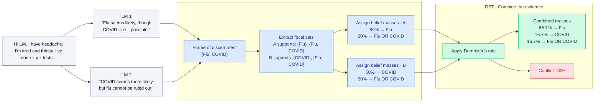
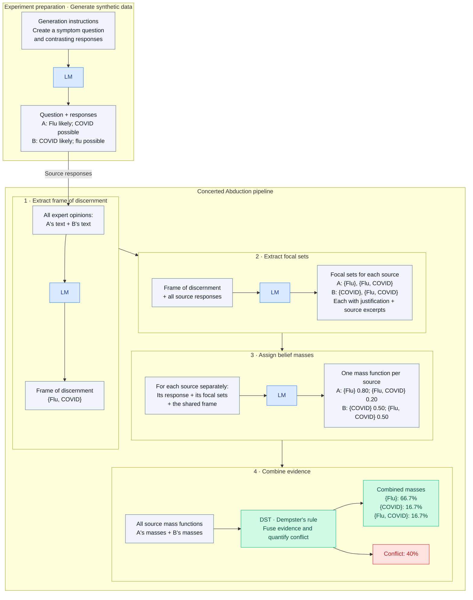

# How it works




[Standalone diagram source](diagrams/pipeline-overview.mmd)

## Synthetic data generator

The data generator is an LM that generates simulated converstions between a human and multiple 'experts'. The human tells the expert their problem, the experts provide their opinions independently (they don't discuss with each other).

For example, a synthetic conversation could look like this:

> **Human:** “I've had a fever, headache, body aches, and a dry cough since yesterday. What could be causing this?”
>
> **Model A:** “Flu seems most likely given the sudden fever and body aches, though COVID is also possible.”
>
> **Model B:** “COVID seems most likely, but flu could explain these symptoms too.”
>
> **Model C:** “Both flu and COVID are plausible. The symptoms alone don't clearly distinguish between them.”

> [!NOTE]
> Models 'A', 'B' and 'C' are *pretend models* and not real.

Generation is run with:

```bash
uv run python scripts/generate_data.py
```

See:

[generation script](../scripts/generate_data.py),
[system prompt](../prompts/data_generators/common_input/v0.txt), and
[examples for the data-generator LM](../data/synthetic/examples/common_input/v0.json)

## Detailed pipeline picture



[Standalone diagram source](diagrams/pipeline-inputs-outputs.mmd)
