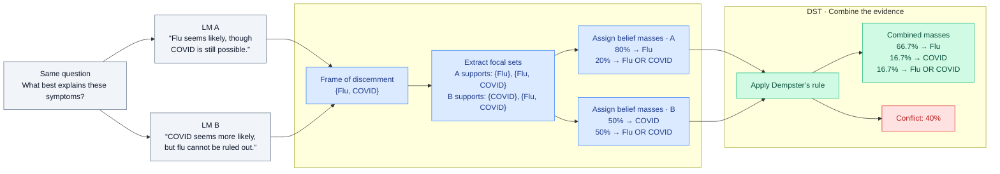
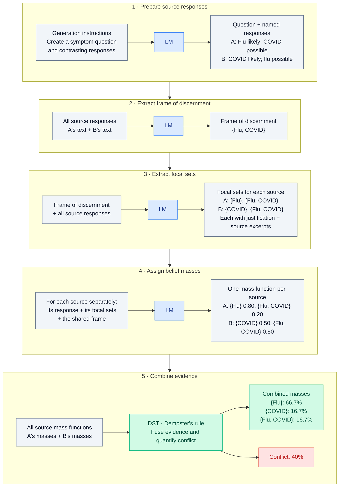

# How it works

This system takes several model responses to the same question, identifies the explanations they support, and combines that support using **Dempster–Shafer theory**.

“Abduction” means reasoning toward plausible explanations. “Concerted” means bringing several sources’ explanations together.

I checked the current implementation on `main`. The complete pipeline exists; the supplied AGENTS.md and parts of `docs/overview.md` still describe an earlier version.

## Inputs and outputs at each stage

The same example is shown below as an input–process–output view. Belief masses are illustrative LM estimates, not calibrated diagnostic probabilities. In this experiment, synthetic source responses are generated together by one LM.

The original responses remain available through focal-set extraction and mass assignment. The final DST stage receives only the numerical mass functions. A mass on `{Flu, COVID}` preserves an unresolved alternative rather than splitting support between the two diagnoses.

**1. Prepare the source responses**

Each scenario contains an input question and several named responses.

For example:

- Model A: “Flu is most likely, though COVID remains possible.”
- Model B: “The symptoms could indicate flu or COVID.”
- Model C: “COVID seems more likely.”

Currently, the synthetic-data generator asks **one Gemini model to invent a whole scenario, including the different sources’ responses**. Those source names therefore do not establish that separate models were actually queried.

**2. Build a shared vocabulary of hypotheses**

An LM reads all the responses and extracts a *frame of discernment*: the common set of candidate explanations.

For this example:

\[
\Theta=\{\text{flu},\text{COVID}\}
\]

The prompt asks it to merge synonyms, use canonical labels, and produce elementary, mutually exclusive hypotheses.

In the current code, this extraction receives the source responses; it does **not** receive the original question separately.

**3. Identify what each source supports**

Another LM call creates *focal sets* for each source. These are subsets of the shared frame, with justifications and verbatim supporting excerpts.

The distinction between these sets matters:

- `{flu}` supports flu specifically.
- `{COVID}` supports COVID specifically.
- `{flu, COVID}` supports “one of these, without resolving which.”

Python checks source coverage, hypothesis membership, and whether quoted excerpts occur in the source text. These checks establish structural consistency and quotation fidelity; they do not establish that the interpretation is correct. Validation warnings are saved, and processing can continue.

**4. Assign belief masses**

The BPA assigner makes a separate LM call for each source. It assigns weights to that source’s focal sets or to the full frame.

An illustrative assignment could be:

\[
m_A(\{\text{flu}\})=0.7
\]

\[
m_A(\{\text{flu},\text{COVID}\})=0.3
\]

Here, \(m_A(S)\) means the mass source A commits to the set \(S\). The second value preserves unresolved uncertainty; it is not automatically split between flu and COVID.

Python requires valid subsets, finite masses between zero and one, no duplicate subsets, and a total of one per source. **The weights themselves are LM estimates, not calibrated probabilities.**

**5. Combine the masses mathematically**

The final stage uses deterministic Python code—no LM call.

For two sources, it multiplies the masses assigned to each pair of focal sets and examines their intersection:

- `{flu}` intersected with `{flu, COVID}` contributes support to `{flu}`.
- `{flu}` intersected with `{COVID}` has an empty intersection and contributes to conflict.

Calling the total conflicting mass \(K\), Dempster’s rule normalizes the remaining contributions:

\[
m(S)=
\frac{\sum_{A\cap B=S}m_1(A)m_2(B)}
{1-K},
\qquad S\ne\varnothing
\]

The implementation extends this across all sources, preserving composite sets. Total conflict causes an error because normalization is undefined.

**What you get**

The [runner](/Users/zayan/Documents/code/mine/research-concerted_abduction_lms/scripts/run.py) saves each stage as `frame.json`, `focal_sets.json`, `bpa.json`, and `combined.json`. The final result contains **combined masses and conflict**, with no generated final answer or diagnosis ranking.

The central research question is how faithfully the LM stages translate language into hypotheses, supported sets, and numerical masses. The combination arithmetic can be correct while those interpretations remain uncertain. The current pipeline also applies no source-reliability discounting or correction for related sources.
